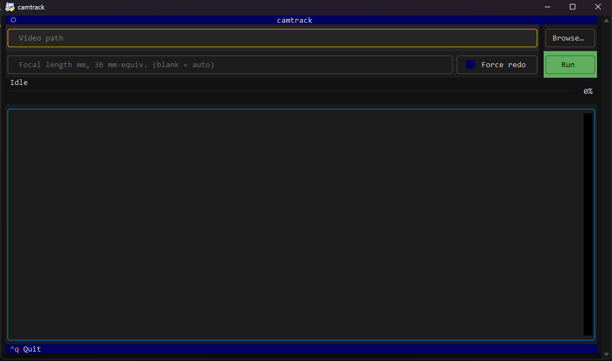

<a id="readme-top"></a>

[![Contributors][contributors-shield]][contributors-url]
[![Forks][forks-shield]][forks-url]
[![Stargazers][stars-shield]][stars-url]
[![Issues][issues-shield]][issues-url]
[![License][license-shield]][license-url]

<h3 align="center">camtrack — Camera Path Creator</h3>

<p align="center">
    Pick a video clip, get a Blender file with the solved camera path, point cloud, shadow catcher and plate — automatically, via COLMAP.
    <br />
    <br />
    <a href="https://github.com/MarcyVibin/camerapath_creator/issues">Report Bug</a>
    &middot;
    <a href="https://github.com/MarcyVibin/camerapath_creator/issues">Request Feature</a>
</p>

<!-- TABLE OF CONTENTS -->
<details>
  <summary>Table of Contents</summary>
  <ol>
    <li>
      <a href="#about-the-project">About The Project</a>
      <ul>
        <li><a href="#how-it-works">How It Works</a></li>
        <li><a href="#built-with">Built With</a></li>
      </ul>
    </li>
    <li>
      <a href="#getting-started">Getting Started</a>
      <ul>
        <li><a href="#requirements">Requirements</a></li>
        <li><a href="#installation">Installation</a></li>
      </ul>
    </li>
    <li><a href="#usage">Usage</a></li>
    <li><a href="#license">License</a></li>
    <li><a href="#contact">Contact</a></li>
  </ol>
</details>

---

## About The Project

**camtrack** turns a video clip into a camera-tracked Blender scene for VFX compositing. It drives
[COLMAP](https://colmap.github.io/) through the whole structure-from-motion solve, polishes the result, and
writes a `.blend` that is ready to put CG into the shot.

Key features:

- One click: select a clip, get `<clip>_camera.blend`
- Every frame solved, so there are no interpolated "wobble" frames
- Polishing passes that merge and extend long tracks, drop bad ones and re-run bundle adjustment
  (for example 0.84 px → 0.40 px mean reprojection error on the sample drone clip)
- Animated camera with the solved lens and distortion (k1), plate as background, sparse point cloud
- Automatic ground fit: the scene is levelled to world XY and a **shadow catcher** is created.
  A bundled script refits the ground from points you select
- Interactive terminal UI (Textual) with a file picker and progress bar
- Headless CLI with JSON output for scripts and AI agents
- Resumable runs: finished steps are skipped
- Separate small UI to rebuild only the `.blend` from an existing COLMAP solve



<p align="right">(<a href="#readme-top">back to top</a>)</p>

### How It Works

```
video ─► frames ─► features ─► match ─► solve ─► polish ─► export ─► blender ─► .blend
        (ffmpeg)   (SIFT)    (sequential, (global   (retriangulate,  (TXT)   (camera, points,
                              guided)     mapper)    filter, BA ×2)           ground, plate)
```

Each step is a plain function in [camtrack/pipeline.py](camtrack/pipeline.py). To extend the
pipeline, add a function and insert it into `STEPS`.

| File | Purpose |
| --- | --- |
| [start_camtrack.py](start_camtrack.py) | Double-click launcher: full pipeline UI |
| [start_blender_import.py](start_blender_import.py) | Double-click launcher: existing solve → `.blend` |
| [camtrack/pipeline.py](camtrack/pipeline.py) | The steps, resume logic, `run()` and `blender_only()` |
| [camtrack/config.py](camtrack/config.py) | Settings and tool discovery (COLMAP, Blender, FFmpeg) |
| [camtrack/tui.py](camtrack/tui.py) | Textual UIs |
| [camtrack/blender_import.py](camtrack/blender_import.py) | Runs inside Blender and builds the scene |
| [camtrack/blender_ground.py](camtrack/blender_ground.py) | Ground fit, levelling and shadow catcher (also stored in every `.blend`) |
| [USAGE.md](USAGE.md) | Short usage guide for humans and AI agents |

<p align="right">(<a href="#readme-top">back to top</a>)</p>

### Built With

* [![Python][Python.org]][Python-url]
* [![COLMAP][COLMAP-badge]][COLMAP-url]
* [![Blender][Blender-badge]][Blender-url]
* [![Textual][Textual-badge]][Textual-url]
* [![FFmpeg][FFmpeg-badge]][FFmpeg-url]
* [![NumPy][NumPy-badge]][NumPy-url]
* Tkinter (built into Python)

<p align="right">(<a href="#readme-top">back to top</a>)</p>

---

## Getting Started

### Requirements

- Windows (tested on Windows 11)
- Python 3.10+
- [COLMAP](https://github.com/colmap/colmap/releases) 4.x. The CUDA build is recommended; tested with 4.2.1
- [Blender](https://www.blender.org/download/) 4.x / 5.x, tested with 5.3
- FFmpeg (`ffmpeg` and `ffprobe` on `PATH`)
- `textual` Python package

### Installation

Install the required dependency:

```sh
pip install textual
```

Then clone the repository:

```sh
git clone https://github.com/MarcyVibin/camerapath_creator.git
cd camerapath_creator
```

The tools are found automatically on `PATH`, at `~/Tools/COLMAP` and in the default Blender install
folder. Override any of them with `CAMTRACK_COLMAP`, `CAMTRACK_BLENDER`, `CAMTRACK_FFMPEG` or
`CAMTRACK_FFPROBE`.

<p align="right">(<a href="#readme-top">back to top</a>)</p>

---

## Usage

**Interactive:** double-click `start_camtrack.py`, press **Browse…** to pick a clip, then **Run**.
You can also drag a video onto the file to run it straight away.

**Headless (scripts / AI agents):**

```sh
python -m camtrack clip.mp4 --json
```

This prints one JSON object with the `.blend` path and the solve stats (registered frames, mean
reprojection error, track length). Exit code 0 means success.

**Already have a solve?** Double-click `start_blender_import.py`, pick the COLMAP model folder and the
video, and press **Run**. It only rebuilds the `.blend`.

**In Blender**, everything sits under `COLMAP_Space`, already levelled so the ground is world XY. Scale
it to real-world size and you're ready to composite. For render settings, manual ground refitting
and quality checks, see [USAGE.md](USAGE.md).

<p align="right">(<a href="#readme-top">back to top</a>)</p>

---

## License

Distributed under the GNU General Public License v3.0 (GPL-3.0). See [LICENSE](LICENSE) for more information.

---

## Contact

Marc Steger - marc.steger06@gmail.com

Project Link: https://github.com/MarcyVibin/camerapath_creator

<p align="right">(<a href="#readme-top">back to top</a>)</p>

<!-- Badge Links -->

[Python.org]: https://img.shields.io/badge/Python-3.10+-3776AB?style=for-the-badge&logo=python&logoColor=white
[Python-url]: https://www.python.org/

[COLMAP-badge]: https://img.shields.io/badge/COLMAP-Structure%20from%20Motion-red?style=for-the-badge
[COLMAP-url]: https://colmap.github.io/

[Blender-badge]: https://img.shields.io/badge/Blender-F5792A?style=for-the-badge&logo=blender&logoColor=white
[Blender-url]: https://www.blender.org/

[Textual-badge]: https://img.shields.io/badge/Textual-Terminal%20UI-blueviolet?style=for-the-badge
[Textual-url]: https://github.com/Textualize/textual

[FFmpeg-badge]: https://img.shields.io/badge/FFmpeg-007808?style=for-the-badge&logo=ffmpeg&logoColor=white
[FFmpeg-url]: https://ffmpeg.org/

[NumPy-badge]: https://img.shields.io/badge/NumPy-013243?style=for-the-badge&logo=numpy&logoColor=white
[NumPy-url]: https://numpy.org/

[contributors-shield]: https://img.shields.io/github/contributors/MarcyVibin/camerapath_creator.svg?style=for-the-badge
[contributors-url]: https://github.com/MarcyVibin/camerapath_creator/graphs/contributors

[forks-shield]: https://img.shields.io/github/forks/MarcyVibin/camerapath_creator.svg?style=for-the-badge
[forks-url]: https://github.com/MarcyVibin/camerapath_creator/network/members

[stars-shield]: https://img.shields.io/github/stars/MarcyVibin/camerapath_creator.svg?style=for-the-badge
[stars-url]: https://github.com/MarcyVibin/camerapath_creator/stargazers

[issues-shield]: https://img.shields.io/github/issues/MarcyVibin/camerapath_creator.svg?style=for-the-badge
[issues-url]: https://github.com/MarcyVibin/camerapath_creator/issues

[license-shield]: https://img.shields.io/github/license/MarcyVibin/camerapath_creator.svg?style=for-the-badge
[license-url]: https://github.com/MarcyVibin/camerapath_creator/blob/main/LICENSE
